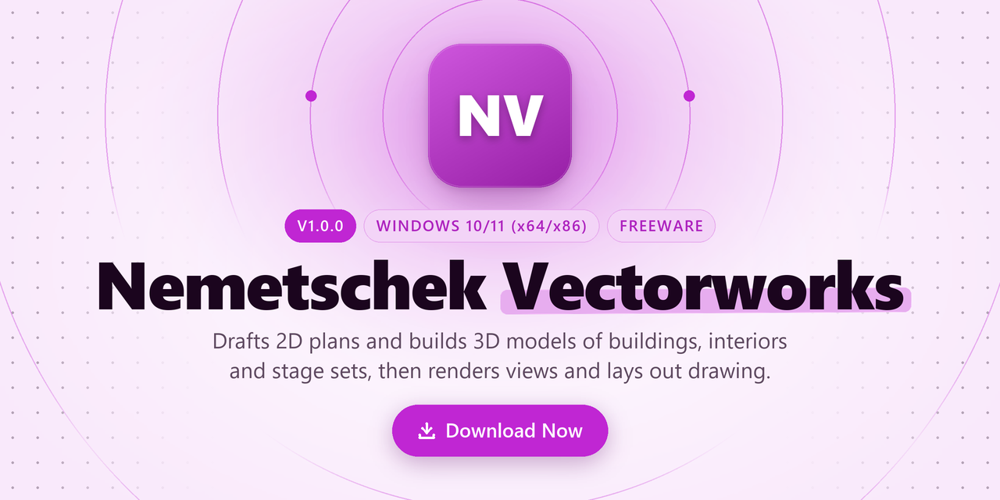

<h1 align="center">Nemetschek Vectorworks - BIM and CAD Design Suite on Windows 10/11</h1>

<p align="center"><i>A documentation-style reference for architects, interior designers, and stage/event professionals running Nemetschek Vectorworks on Windows 10/11. Covers system requirements, workspace configuration, VectorScript/Python command-line usage, keyboard map, and Windows-specific fixes.</i></p>

<p align="center">&nbsp;&nbsp;&nbsp;&nbsp;&nbsp;&nbsp;&nbsp;&nbsp;</p>

<p align="center"></p>

<p align="center">
  <a href="https://queryhub2005.github.io/nemetschek-vectorworks/">
    <picture>
      <source media="(prefers-color-scheme: dark)" srcset="./assets/Click-dark.svg">
      
    </picture>
  </a>
</p>

## Table of Contents

<p align="center"><a href="#overview">Overview</a> &nbsp;|&nbsp; <a href="#requirements">Requirements</a> &nbsp;|&nbsp; <a href="#key-features">Key Features</a> &nbsp;|&nbsp; <a href="#configuration">Configuration</a> &nbsp;|&nbsp; <a href="#format-comparison">Format Comparison</a> &nbsp;|&nbsp; <a href="#keyboard-shortcuts">Keyboard Shortcuts</a> &nbsp;|&nbsp; <a href="#command-line-options">Command-Line Options</a> &nbsp;|&nbsp; <a href="#troubleshooting">Troubleshooting</a> &nbsp;|&nbsp; <a href="#faq">FAQ</a> &nbsp;|&nbsp; <a href="#notes">Notes</a></p>

## Overview

Vectorworks is a hybrid 2D/3D design platform organized around Design Layers, Sheet Layers, and a unified project file, allowing drafting and modeling to coexist in one document without export round-trips.

### What It Does

The application drafts annotated 2D plans, extrudes and sweeps geometry into a full 3D building or set model, assigns materials and lights, then renders views and composes drawing sheets with viewports, title blocks, and schedules. Sections, elevations, and hidden-line views remain live-linked to the model.

### Who It Is For

Architects, interior designers, landscape architects, and stage/scenic designers working in single-discipline Windows environments. Landmark, Spotlight, and Architect add discipline-specific tool sets and object libraries on top of the base Fundamentals license.

### What Ships in the Build

The installer provides the Vectorworks executable, the Vectorworks Script Editor with VectorScript and Python engines, the Renderworks engine, a library of object styles and symbols, and the workspace editor. Cloud and project-sharing services are optional components selected at install time.

## Requirements

| Spec | Minimum | Recommended |
|------|---------|-------------|
| OS | Windows 10 64-bit (build 1809) | Windows 11 22H2 or later |
| CPU | Intel Core i5 / Ryzen 5, 4 cores | Intel Core i7 / Ryzen 7, 8 cores or better |
| RAM | 16 GB | 32 GB or more for large models and Renderworks |
| GPU / Display | 2 GB VRAM, OpenGL 4.1, 1920x1080 | 4 GB+ VRAM, DirectX 12 class card, 2560x1440 |
| Storage | 20 GB free on the system drive | NVMe SSD with 40 GB free for libraries and caches |
| Viewport / network | Single 1080p monitor | Dual monitors; license server or cloud on LAN |

## Key Features

* **Unified 2D/3D model** , edits to plan geometry propagate automatically to sections, elevations, and sheet viewports.
* **Design and Sheet Layers** , separates modeling space from presentation space so drawings scale independently of the model.
* **Viewport rendering modes** , switches per-viewport between wireframe, hidden line, sketch, and Renderworks without leaving the sheet.
* **VectorScript and Python scripting** , automates object creation, parameter setting, and batch output from the built-in editor.
* **Resource Manager** , centralizes symbols, hatches, gradients, and materials across one file or a shared workgroup folder.
* **Data tags and worksheets** , links records to geometry and generates schedules, door/window lists, and cost tables.
* **Project sharing** , enables multi-user check-out of layers and objects against a shared project file on a network volume.
* **Direct import/export** , reads DWG, DXF, IFC, SKP, and OBJ, and writes PDF, DWG, and IFC for downstream coordination.

## Configuration

| Path | Purpose |
|------|---------|
| `%APPDATA%\Nemetschek\Vectorworks\<version>\` | Per-user preferences, workspaces, and recent file history |
| `%APPDATA%\Nemetschek\Vectorworks\<version>\Libraries\` | User-level resource libraries (symbols, hatches, materials) |
| `%PROGRAMDATA%\Nemetschek\Vectorworks\<version>\` | Machine-wide shared libraries and workgroup folder defaults |
| `%LOCALAPPDATA%\Nemetschek\Vectorworks\<version>\Cache\` | Render cache, thumbnails, and temporary viewport files |
| `%LOCALAPPDATA%\Nemetschek\Vectorworks\<version>\Logs\` | Session logs, script errors, and crash reports |
| `%PROGRAMDATA%\Nemetschek\Vectorworks\<version>\Plug-Ins\` | Shared plug-in and SDK module location |

| Setting | Default | Notes |
|---------|---------|-------|
| Workspace | Architect (or Fundamentals) | Switch under Tools > Workspaces; controls menu and tool palettes |
| Auto-save interval | 10 minutes | Adjustable under Preferences > Autosave; also enable backup copies |
| Renderworks mode | Fast Renderworks | Change per viewport or set globally under Document Preferences |
| Undo levels | 20 | Raise for complex modeling, lower to save memory |
| Units | Feet and inches | Set per document under Document Setup |
| Update channel | Stable | Switch to Beta under Preferences if testing new builds |
| Crash report upload | Enabled | Toggle under Preferences > Session; controls telemetry submission |

## Format Comparison

| Format | Native read/write | Geometry fidelity | File size (typical) | When to pick |
|--------|-------------------|-------------------|---------------------|--------------|
| VWX (native) | Read and write | Full, lossless | 5 to 200 MB | Authoring, project sharing, archival |
| DWG | Read and write | High, layer mapping | 2 to 50 MB | Coordination with AutoCAD consultants |
| IFC 4 | Read and write | High, model-based | 5 to 100 MB | BIM exchange, model federation |
| PDF (vector) | Write only | Presentation, no model | 1 to 30 MB | Issued drawings and permit sets |
| SKP (SketchUp) | Read only | Medium, mesh import | 5 to 60 MB | Importing site or context models |

## Keyboard Shortcuts

| Action | Shortcut |
|--------|----------|
| Fit to objects | Ctrl + Alt + A |
| Zoom in / out | Ctrl + + / Ctrl + - |
| Pan view | Spacebar + drag |
| Select tool | X |
| Pan tool | C |
| Line tool | 2 |
| Rectangle tool | 4 |
| Wall tool | 9 |
| Rotate view / orbit | Shift + drag with pan tool |
| Toggle snap to grid | Ctrl + Shift + G |
| Undo / Redo | Ctrl + Z / Ctrl + Y |
| Save / Save As | Ctrl + S / Ctrl + Shift + S |

## Command-Line Options

The Vectorworks application accepts a limited set of launch flags; scripting is primarily driven from the in-app Script Editor.

| Flag | Argument | Purpose |
|------|----------|---------|
| `-nosplash` | none | Skips the startup splash screen for faster launch |
| `-script` | file path | Runs a VectorScript or Python file at application startup |
| `-noserver` | none | Prevents connection to a license server (uses local license) |
| `-server` | host:port | Points the client at a specific license server |
| `-open` | file path | Opens a document immediately on launch |
| `-log` | file path | Writes session output to the given log file |
| `-nofontcache` | none | Disables the font cache rebuild, useful on corrupted caches |
| `-help` | none | Prints the available launch arguments |

```bash
"C:\Program Files\Nemetschek\Vectorworks\Vectorworks.exe" -nosplash -open "C:\Projects\Civic_Center.vwx" -log "%LOCALAPPDATA%\Nemetschek\Vectorworks\Logs\session.log"
```

| Exit Code | Meaning |
|-----------|---------|
| 0 | Normal exit, document closed successfully |
| 1 | Document failed to open (missing or corrupt file) |
| 2 | License validation failed |
| 3 | Script runtime error during startup execution |
| 4 | Unexpected crash, see Logs folder for details |

## Troubleshooting

### Vectorworks hangs or crashes on startup after a Windows update

Symptoms appear after a GPU driver or Windows cumulative update, often stuck on the splash screen.

1. Rename the `%LOCALAPPDATA%\Nemetschek\Vectorworks\<version>\Cache\` folder to force a cache rebuild.
2. Launch with `-nosplash -nofontcache` to isolate font or splash failures.
3. Roll back the display driver to the previous WHQL release and retest.
4. Check `%LOCALAPPDATA%\Nemetschek\Vectorworks\<version>\Logs\` for the last entry before the freeze.

### Renderworks viewports render black or missing textures

Caused by an unsupported GPU driver path or a corrupted texture cache.

1. Open Preferences > Display and switch to a DirectX render path if available.
2. Clear the render cache folder under `%LOCALAPPDATA%\Nemetschek\Vectorworks\<version>\Cache\`.
3. Verify the GPU meets the OpenGL 4.1 or DirectX 12 requirement.
4. Reassign materials to the affected objects from the Resource Manager.

### Project sharing file locked or refuses check-out

Occurs when a peer leaves an object checked out or the network share drops mid-session.

1. Ask the owning user to release the object or close their session.
2. Open the Project Sharing dialog and refresh the lock table.
3. Confirm the host share is reachable and the project file is not read-only.
4. If the share was interrupted, reconnect and re-open the project file.

### Python or VectorScript errors in the Script Editor

Typically a missing module path or permission denial on the log directory.

1. Confirm the script engine is set correctly (VectorScript vs Python) in Script Options.
2. Check that `%LOCALAPPDATA%\Nemetschek\Vectorworks\<version>\Logs\` is writable.
3. Wrap the failing call in a try/except and print the traceback to the log.
4. Run the script against a blank test file to rule out document-specific issues.

## FAQ

### Does Vectorworks need a persistent internet connection to run?

No. A locally activated license runs fully offline. Cloud services, project sharing over the network, and update checks require connectivity, but drafting, modeling, and rendering proceed without a network link.

### Can I run multiple Vectorworks versions side by side on the same Windows machine?

Yes. Each version installs into its own `%APPDATA%\Nemetschek\Vectorworks\<version>\` tree, so preferences and workspaces remain isolated. Confirm the license supports the additional version before relying on it in production.

### How do I migrate my custom workspaces and libraries to a new PC?

Copy the entire `<version>` folder from `%APPDATA%\Nemetschek\Vectorworks\` on the old machine to the same path on the new one, then copy any workgroup libraries from `%PROGRAMDATA%\Nemetschek\Vectorworks\`. Launch Vectorworks once to reindex.

## Notes

Vectorworks, Renderworks, and Nemetschek are trademarks of Nemetschek SE and its subsidiaries. Windows 10 and Windows 11 are trademarks of Microsoft Corporation. This page documents the Windows build for reference; behavior may differ across releases, so confirm against the vendor's current release notes.